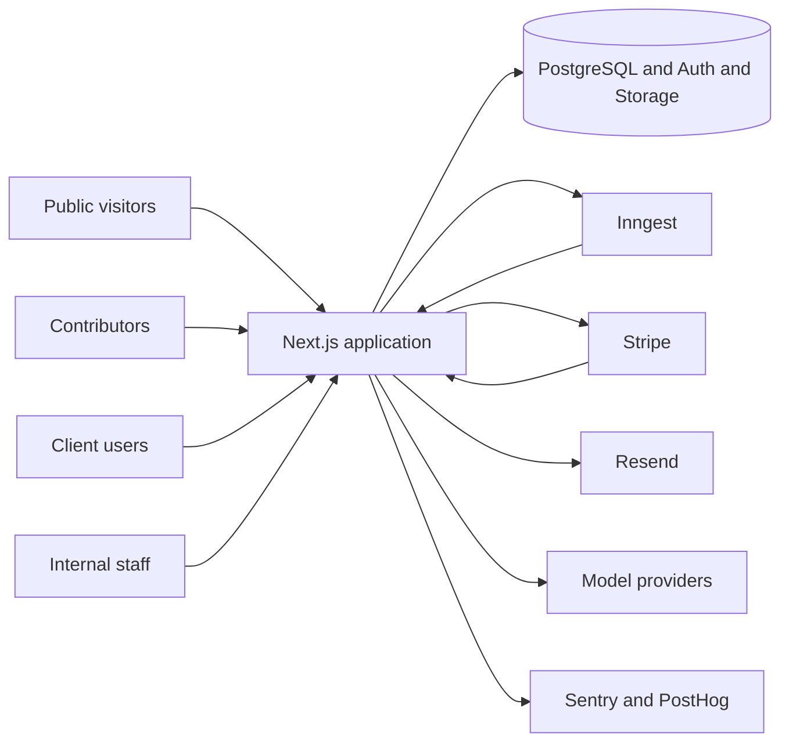
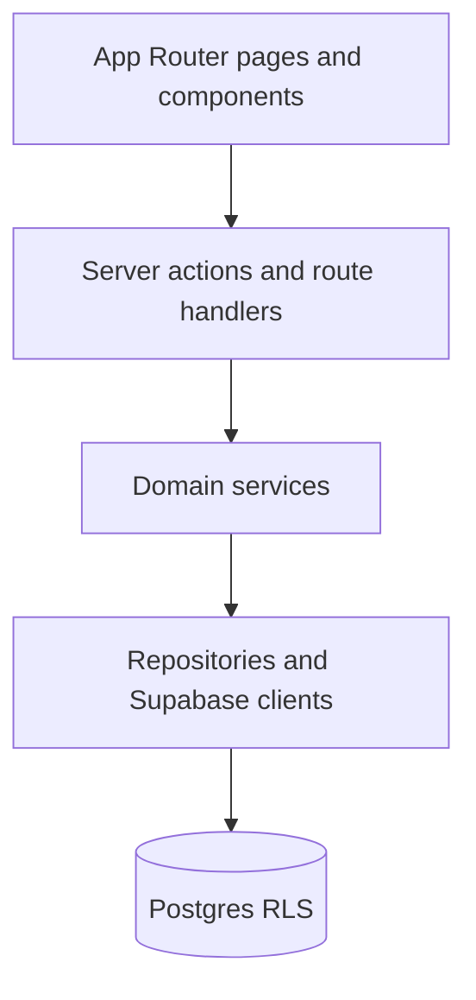
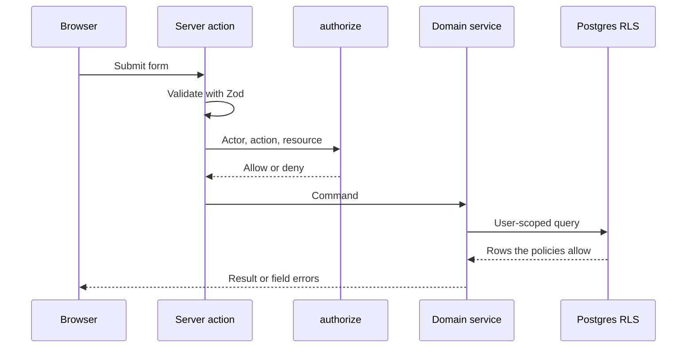

# Architecture

Status: Implemented with the application foundation. The approved shape is a modular monolith on the stack in [TECH_STACK.md](TECH_STACK.md). Decisions are recorded in [ARCHITECTURE_DECISIONS.md](ARCHITECTURE_DECISIONS.md).

## System context

Browsers talk only to the Next.js application. The service-role database key, Stripe secret, provider keys, and email key stay on the server.

## Application layers

UI components do not authorize and do not call provider SDKs. Server actions validate input, call `authorize`, then call a domain service. Repositories are the only database boundary.

## Domain boundaries

| Domain | Responsibility | Must not |
| --- | --- | --- |
| Identity and Access | Accounts, sessions, roles, authorization | Calculate pay |
| Organizations | Client tenants and membership | Store task payloads |
| Contributors | Profiles and qualification state | See other contributors' work |
| Assessments | Versioned exams and attempts | Expose answer keys early |
| Projects | Delivery records, members, milestones | Mark earnings paid |
| Tasks | Templates, assignments, locks, drafts | Approve their own review |
| Submissions | Versioned work product | Bypass exclusive assignment |
| Quality Assurance | Rubrics, reviews, disputes | Approve earnings by itself |
| AI Integrations | Provider adapters and usage records | Be imported by client components |
| Enterprise Delivery | Inquiry through support, internal notes | Mix notes into the client timeline |
| Billing and Payments | Invoices, ledger, webhooks, payout records | Treat an invoice as a payout |
| Notifications | In-app records and email requests | Fail a payment because email failed |
| File Management | Type, size, signed URLs, access log | Put private buckets on the public internet |
| Analytics | Metrics from stored rows | Invent numbers |
| Administration | Account status and support tools | Use a shared superuser password |
| Audit and Compliance | Append-only sensitive-action records | Update history in place |

## Request flow

Payment webhooks are different. Stripe calls a route handler. The handler checks the signature, writes the event id once, then moves the ledger. A second delivery of the same event id does nothing.

## Database access

- User requests use the anon key plus the user session. Row Level Security is the backstop.
- Webhooks, migrations, and audit writes that must outlive the user session use the service-role client in `src/server/db/admin.ts`.
- That module imports `server-only`. It is not referenced from `src/components` or client pages.
- Schema changes are SQL files in `supabase/migrations`.

## Background work

Inngest functions live under `src/server/inngest`. They retry. Email is its own step. If email fails, the function records the failure and leaves the domain state that already committed.

## Error handling

Domain functions return a result object with a stable error code. Route handlers map that to HTTP. Operational failures write one JSON line to the server log with an event, a code, and an error id. The line omits passwords, tokens, email addresses, and message text. A set `SENTRY_DSN` does not send events, because the Sentry package is not installed. Users see a generic message. A page error can show its digest. It does not show a stack trace.

## Deployment

One Next.js deployment. Separate Supabase projects and env vars for development, staging, and production. See [DEPLOYMENT.md](DEPLOYMENT.md).

## Code map

- `src/app` — routes, layouts, route handlers
- `src/components` — shared UI
- `src/features` — feature UI and feature schemas
- `src/services` — pure domain rules, tested without a database
- `src/server` — Supabase, auth context, repositories, jobs, webhooks
- `src/config` — environment parsing
- `supabase/migrations` — schema and policies
- `supabase/seed` — development-only seed
