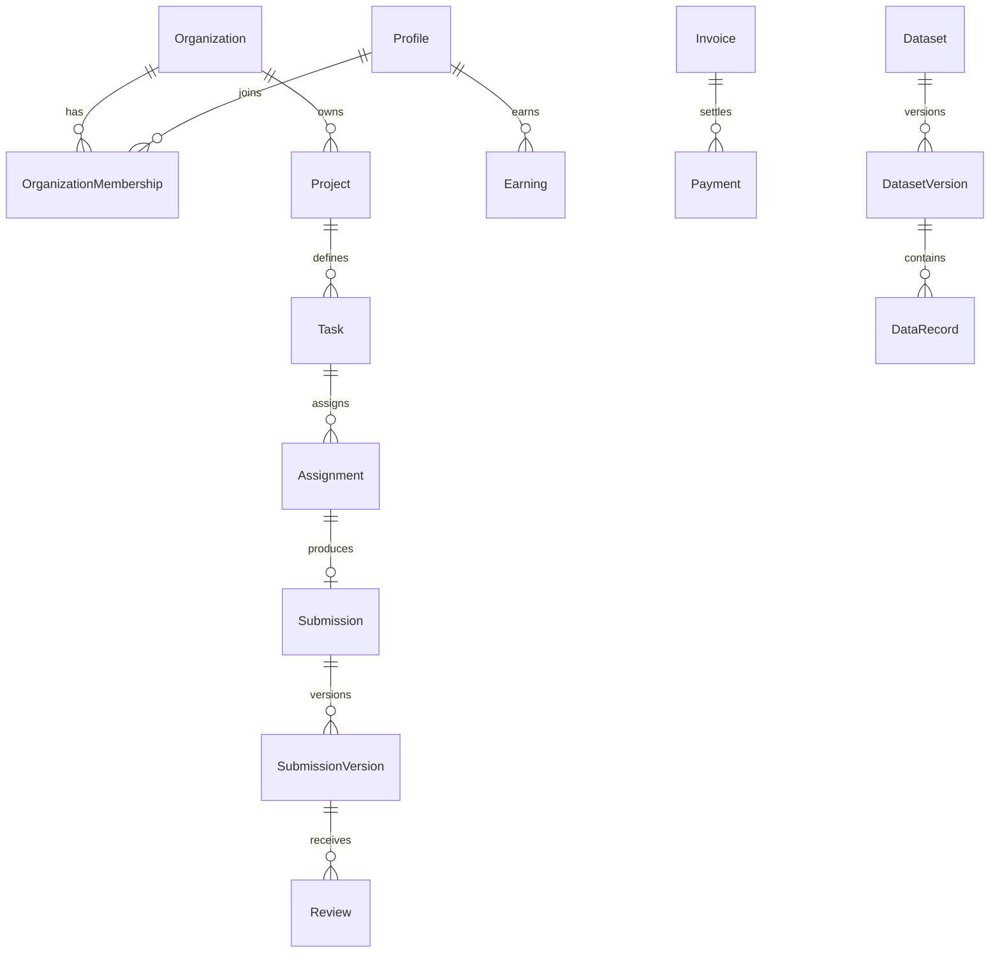

# Domain model

The database is the source of these names. Types in `src/services` mirror them. Primary keys are UUIDs. Mutable tables have `created_at` and `updated_at`. Ledger and audit tables are append-only.

## Identity

- **User** — Supabase Auth user. Email, password hash, and session live there.
- **Profile** — `id` equals the auth user id. Holds `account_kind` (`contributor`, `client`, `staff`), `account_status` (`pending_verification`, `active`, `suspended`, `deactivated`), and `platform_role` for staff and for the external roles `contributor`, `client_owner`, and `client_member`.
- **Organization** — a client tenant.
- **Organization membership** — user, organization, and role `owner` or `member`.

A person is a contributor, a client user, or a staff user. Public registration can create the first two. Staff rows are created only by an invitation flow.

## Contributor

- **Contributor profile** — skills, education, experience, languages, portfolio links, availability hours, country, time zone, completeness, and qualification status.
- Qualification status: `registered`, `profile_incomplete`, `pending_assessment`, `under_review`, `qualified`, `rejected`, `suspended`.

## Assessment

- **Assessment** — a named exam for one expertise category.
- **Assessment version** — immutable question set once published.
- **Question** — type `multiple_choice`, `written`, `coding`, `mathematics`, `scientific`, `domain`, or `file`. Objective questions store a private answer key.
- **Attempt** — contributor, version, answers, score, and review state. Attempts are not deleted when a new version ships.

## Work

- **Project** — type `data_operations`, `model_evaluation`, `consulting`, `application`, `agent`, or `integration`. Belongs to one organization. Has visibility `invite_only` or `qualified_pool`, capacity, required skills, required assessments, languages, and an optional country list that must include a written legal reason.
- **Project member** — staff or client user on that project.
- **Milestone, deliverable, client approval, internal note, client update** — delivery records. Notes and updates are different tables.
- **Task** — project, format, versioned instructions and payload schema.
- **Assignment** — task, contributor, expiration, lock holder, status.
- **Submission** — assignment plus current status.
- **Submission version** — payload and timestamp. Resubmission adds a version.
- **Review** — reviewer, submission version, state, score, comment, layer number.

Review states: `submitted`, `queued`, `under_review`, `approved`, `revision_required`, `rejected`, `disputed`.

Task formats: `text_annotation`, `classification`, `prompt_creation`, `response_evaluation`, `response_ranking`, `preference_comparison`, `coding`, `mathematics`, `scientific_reasoning`, `structured_extraction`, `image_annotation`, `audio_annotation`, `video_annotation`.

## Data operations

- **Dataset, dataset version, data source, data record.**
- **Annotation schema, annotation job, annotation result.**
- **Preference pair, evaluation run, evaluation criterion, benchmark, quality report.**

A version has a stage: `raw`, `processed`, or `approved`. Exports read `approved` only.

## Money

- **Quote, proposal, invoice, payment, refund.**
- **Earning** — states `pending`, `approved`, `payout_initiated`, `paid`, `payout_failed`.
- **Ledger entry** — immutable amount, currency, direction, and reason. Corrections are new rows.
- **Webhook event** — provider event id, unique. Replays do not insert a second row.
- **Payout batch** — groups approved earnings. Stripe Connect fields are nullable until that payout path is enabled.

Creating an invoice does not change an earning.

## Other

- **Lead** — public inquiry. Anonymous users can insert. Only staff can read.
- **Notification, message, support ticket, file object, audit event, AI request log.**

## Relationships

